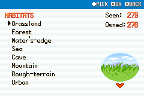
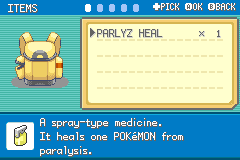
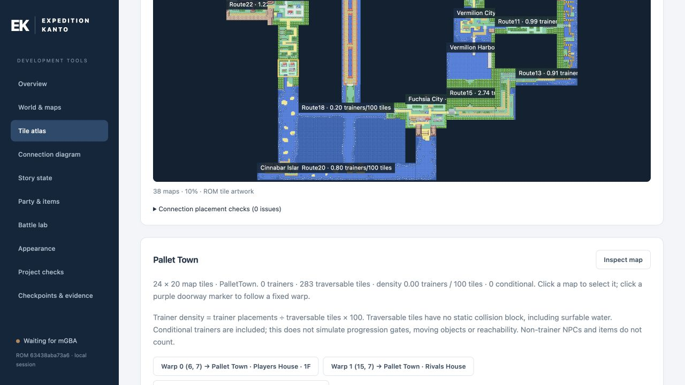

# Pokémon Expeditions Kanto

An unofficial FireRed fan modification about exploration, research and the different ways Pokémon grow. Created by Dee Kariyawasam.

**Development preview.** Player releases use BPS patches. No full game ROM or save belongs in a release download. See [installation and release instructions](RELEASE.md), [credits](docs/credits/README.md) and [rights and attribution](RIGHTS.md). The project is not affiliated with or endorsed by the original rights holders.

## Features

- Open Kanto exploration, with scalable Gym Leader challenges and field tools earned through their trials.
- Three connected storylines: the Gym Leader Trials, Apex investigations, and Giovanni’s Ambition, culminating in Oak’s expedition certificate.
- An Indigo League of four double-battle rounds followed by the rival, and a Rocket League of four single-battle rounds followed by Giovanni.
- Rare surviving primeval Pokémon and fossil reconstructions assembled from complementary fragments at Cinnabar Lab.
- In-game trades for trade evolutions, plus Blaine’s quiz terminal for Porygon upgrades.
- Pokédex page rewards, habitat completion rewards, and a Field Aide card recognizing the League, obtainable collection, and Rocket League milestones.
- Two player styles, independent accent colours, and matching blue, rose, or green interface themes.
- A shared menu interface, an expedition Logbook, and an updated regional map.

## Development status

This is a development build. Battle-sprite completion and the final release pass remain open. The playthrough and trainer line-of-sight reviews were accepted on October 12. The [playthrough record](docs/release-playthrough/forest-brock-oct12/README.md) and [trainer avoidance review](docs/release-playthrough/trainer-avoidance-oct12/README.md) preserve the actual coverage and limitations. Patch Disc distribution/Porygon3 and additional ferry destinations remain deliberately deferred.

See the [project credits](docs/credits/README.md) and [asset attribution records](docs/credits/attribution-sources.md). Original artist mappings that are not yet confirmed remain identified as unresolved.

## Screenshots

Recorded development builds; wording and artwork may differ from the latest build.

## Design devlogs

Read the [21-post devlog series](docs/blog/README.md) or use the [feature and design guide](docs/blog/feature-guide.md) to explore the expedition themes, evolution systems, collection rewards and interface decisions.

## Development dashboard

The [local debug dashboard](tools/debug_dashboard/README.md) connects to mGBA for live map, story, party, battle, appearance and palette checks. Launch it with `tools/debug_dashboard/Launch.command`; its connection guide uses a separate test ROM and save.

## Build from source

See [build dependencies](INSTALL.md). This modified game is built with `make COMPARE=0`; vanilla checksum comparisons are not expected to pass. Full ROMs and emulator data remain local and ignored. The embedded upstream multiboot dependency remains in the source tree as described in [RIGHTS.md](RIGHTS.md).
