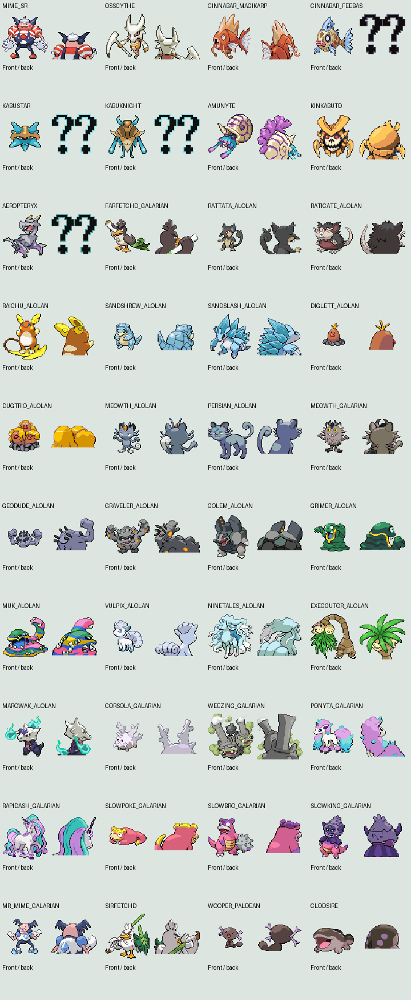
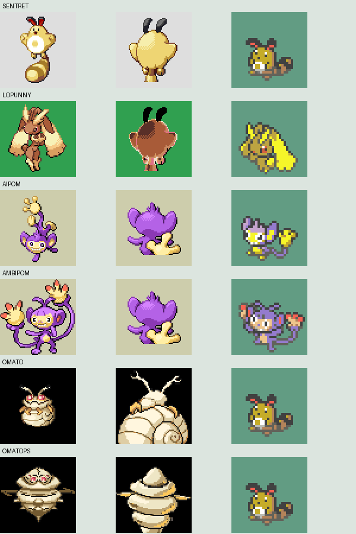

# Pokémon artwork review — 2026-10-18

All 404 active species were scanned for source validity and identical indexed pixel data. Suspicious duplicates and custom/regional battle sprites were visually inspected. This is not a full artistic review of every frame or a live battle test.

## Confirmed problems

| Species | Asset | Finding |
|---|---|---|
| Deep Form Feebas | Back | Registered question-mark placeholder |
| Kabustar | Back | Registered question-mark placeholder |
| Kabuknight | Back | Registered question-mark placeholder |
| Aeropteryx | Back | Registered question-mark placeholder |
| Lopunny | Back | Fixed: sourced distinct back sprite; see replacement report |
| Ambipom | Back | Fixed: sourced distinct back sprite; see replacement report |
| Omato | Menu icon | Identical indexed pixels to Sentret; visibly the wrong species |
| Omatops | Menu icon | Identical indexed pixels to Sentret; visibly the wrong species |

Deep Form Feebas also intentionally uses the ordinary Feebas menu icon as a temporary replacement for the question mark. A bespoke icon is still needed.

## Limits and non-problems

No blank battle/menu artwork, unexpected dimensions, or non-4bpp indexed battle/menu source images were flagged by the structural audit. Several evolutionary families share registered palettes; sharing alone is not a defect. Identical indexed pixels establish shape reuse, not necessarily identical displayed colours. A presence check is not evidence of correct artwork: the previous all-404-present result included question-mark back sprites.

Lopunny and Ambipom fixed after this initial audit: [source and preview](../lopunny-ambipom-backs/README.md). The comparison images above retain the original findings.
