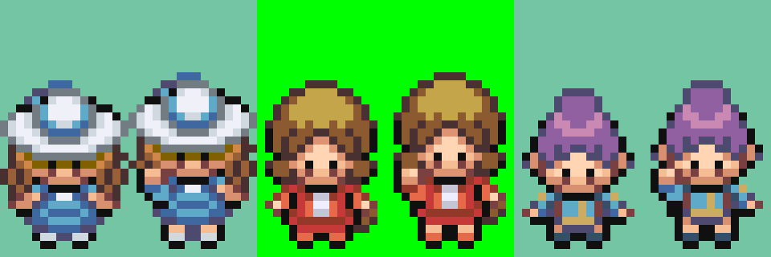
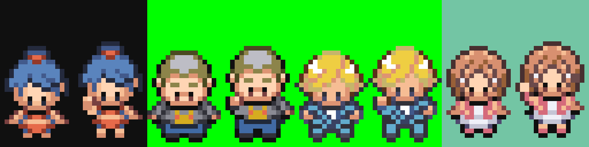
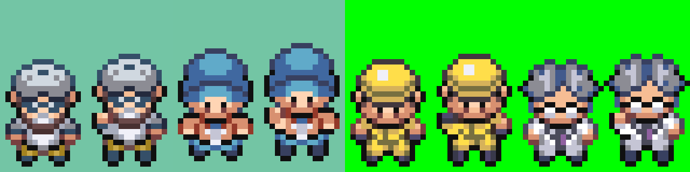

# Rechallenge pose review — 13 October 2026

Preview pairs show the standing frame followed by the new frame 10: Lady, Pokéfan F, Psychic F. All use the character’s right arm (viewer left), a one-pixel upper-body lift and the original palette. Frames 1–9 are unchanged. Psychic F now has a real tenth frame instead of the standing-frame fallback.

The initial generated arm details were rejected because they read as flipped arms. The revised poses use the completed Ace Trainer F's native-pixel bent-arm structure: fist and forearm above the sleeve, elbow projecting outward, and a tapered connection to the shoulder. Each arm is mapped to its character's existing skin and clothing colours. Original hair and outfit pixels surrounding the rejected patches were restored. The body lift is retained. Following visual review, the coloured shoe row retains its original colours and the row immediately above uses skin colours; the dark sole/outline row is unchanged.

ROM build passed and all ten packed frames match their source pixels. Visual approval and live rechallenge playback remain pending.

## Second group

Black Belt F, Pokéfan M and Trendsetter M use the same completed Ace F elbow/forearm structure, mapped to their own palettes. Black Belt F has a bare arm rather than a sleeve. All retain their original shoe and sole rows. Pokéfan M and Trendsetter M retain trouser colours above their shoes; exposed legs use skin only for the skirt/shorts outfits. Aroma Lady received only the shoe/skin correction; her arm and upper body were preserved.

Frames 1–9 and all palette colours remain unchanged. Each pair shows standing then rechallenge.

## Workwear group

Burglar, Electrician, Engineer and Scientist now have a bent-right-arm tenth frame with the one-pixel lift. Original trousers, shoes and soles remain; Engineer keeps his glove colours and Electrician keeps a bare arm. Frames 1–9 and existing palettes are unchanged. Visual approval is pending.

