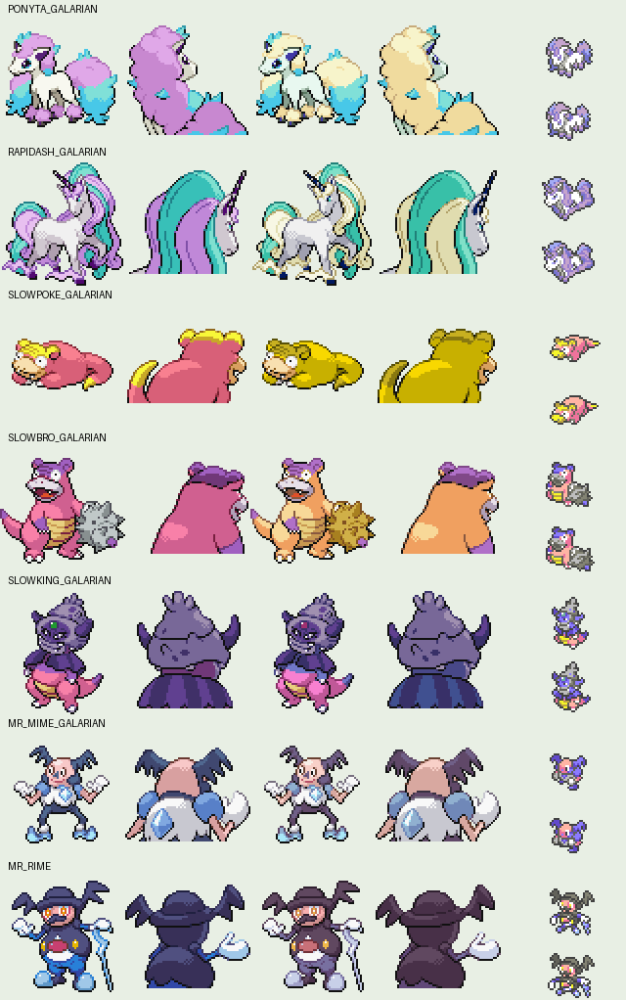

# Galar additions

Added Galarian Ponyta, Rapidash, Slowpoke, Slowbro, Slowking and Mr. Mime, plus Mr. Rime.

Safari encounters: Ponyta in Center, Mr. Mime in North, and Slowpoke in West. Existing species remain available. Ponyta evolves at level 40 and Mr. Mime at level 42. The Center rest-house researcher sells Galarica Cuff and Galarica Wreath: use them on Galarian Slowpoke for Slowbro and Slowking respectively. The Wreath's inventory name is shortened to GALAR WREATH for the engine's name limit.

## Sources and adaptation

Front/back sprites, normal/shiny palettes, menu icons, Mr. Rime's footprint and Galarica item icons come from [rh-hideout/pokeemerald-expansion](https://github.com/rh-hideout/pokeemerald-expansion/tree/803bcb7c58afe73b0831893f383e6ce07fe0bac2/graphics), pinned at `803bcb7c58afe73b0831893f383e6ce07fe0bac2`. These are community GBA adaptations of official Pokémon designs, not official GBA sprites. See the retained [upstream contributor credits](../roserade-alolan-sprites/upstream-credits.md); individual asset authors remain subject to the project's attribution research.

Source directories are `graphics/pokemon/{ponyta,rapidash,slowpoke,slowbro,slowking,mr_mime}/galar`, `graphics/pokemon/mr_rime` and `graphics/items/icons`. Front sprites use the first 64×64 frame. Icons are mapped to the game's existing menu palettes. Regional footprints reuse their Kanto relatives' footprints.

Stats, types and learnset references come from the [PokéAPI static data archive](https://github.com/PokeAPI/api-data). Species IDs are 10162, 10163, 10164, 10165, 10172, 10168 and 866 respectively. Sword/Shield level-up lists are restricted to implemented moves; Slowbro and Slowking also receive Sludge and Sludge Bomb for usable Poison attacks. Initial Mr. Mime/Rime move ordering keeps attacks available at encounter levels.

Cries are original game recordings distributed by the community [PokéAPI cries archive](https://github.com/PokeAPI/cries), converted to full-length mono 10512 Hz unsigned 8-bit WAV. Exact URLs and checksums are in [cry-imports.json](../cry-imports.json). Source-file hashes are in [manifest.json](manifest.json).

Supported official abilities are Run Away (Ponyta/Rapidash), Own Tempo (Slowpoke's family), Vital Spirit (Mr. Mime) and newly implemented Ice Body (Mr. Rime). Other official ability options and unsupported signature moves are not implemented by this addition. Ice Body restores 1/16 maximum HP in effective hail and prevents hail damage.

## Validation

The ROM builds. `tools/test_galar_additions.py` checks stable existing species/Dex IDs, the preserved 62-byte save flag fields, asset coverage, obtainability, evolution branches and Ice Body behavior. Evolution-item, active-Pokédex and cry-import checks also pass. Live emulator encounter and battle testing remains outstanding.

