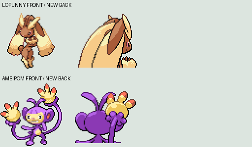

# Lopunny and Ambipom back sprites

Imported 2026-10-18 from rh-hideout/pokeemerald-expansion. Replaces the Sentret-shaped Lopunny back and duplicated Aipom back.

Upstream revision recorded during retrieval: `73b3fbeb574327cd9420c89e56bef5aa3c08fead`. Downloads were from master; SHA-256 fingerprints below identify the exact imported files.

## Lopunny

Source: https://github.com/rh-hideout/pokeemerald-expansion/blob/master/graphics/pokemon/lopunny/back.png

Downloaded PNG SHA-256: `529c73ae5a57b6b4a495dfb9cc0c4c4f6de92460705ec3c73e4d2bbe0c73bb75`.

## Ambipom

Source: https://github.com/rh-hideout/pokeemerald-expansion/blob/master/graphics/pokemon/ambipom/back.png

Downloaded PNG SHA-256: `7991afc004f438877b42a6140eaba9044c67e5845446ee5d51ebaf593eb45ba1`.

Pixel geometry preserved. Source indices remapped to the existing local normal/shiny palette slots; no front artwork or shared palette was replaced. Both outputs remain 64×64, indexed, 4bpp-compatible.

Credit: rh-hideout/pokeemerald-expansion asset contributors; Pokémon designs belong to their original creators. Individual back-sprite artist attribution remains unverified; do not infer authorship from the repository maintainer or importer. See https://github.com/rh-hideout/pokeemerald-expansion/blob/master/CREDITS.md and the project attribution-completion notice.

